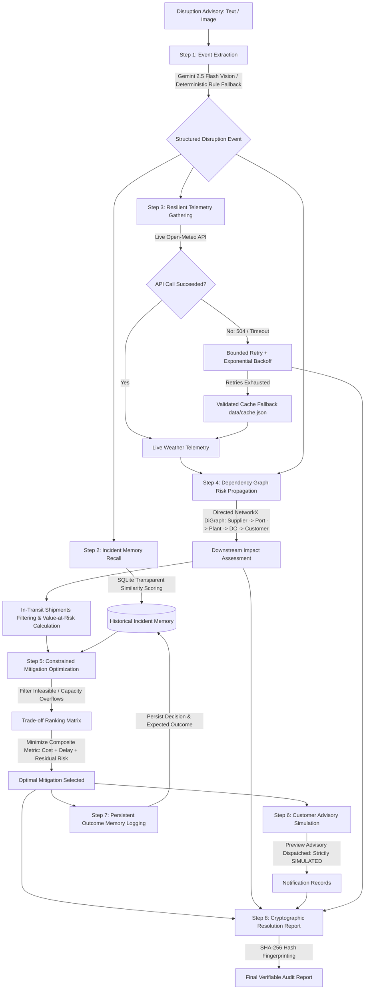

# ChainSight Agent: Autonomous Supply Chain Risk Detection, Recovery & Memory System

[](tests/)
[](tools/mcp_server.py)
[](api.py)
[](app.py)
[](schemas.py)

ChainSight is an AI-powered agentic supply-chain disruption response system. It autonomously ingests multimodal alerts, traces downstream consequences through directed multi-echelon dependency graphs, retrieves historical incident memory, evaluates feasible recovery actions under hard capacity constraints, self-heals from tool failures with exponential backoffs and validated contingency caches, and generates tamper-evident, cryptographically verifiable resolution reports.

---

## 🏗️ Architecture & Detailed Workflow

### End-to-End Autonomous Agent Pipeline



### Detailed Pipeline Stages

1. **Disruption Extraction & Normalization**:
   - Ingests free-form operator text, cyclone advisories, or port bulletins.
   - Extracts structured `DisruptionEvent` (Event Type, Normalized Location, Severity, Estimated Duration, Affected Entities, and Confidence).
   - If an API key is missing or offline, switches seamlessly to deterministic heuristic rule extraction.
2. **Persistent Experience Memory Recall**:
   - Queries `chainsight_memory.db` using transparent scoring (+40 location match, +30 event type match, +15 severity match, +5 entity overlap).
   - References prior successful playbooks and observed outcomes to guide current decision-making.
3. **Self-Healing Telemetry Gathering**:
   - Queries Open-Meteo for live wind speeds, precipitation, and conditions.
   - If network faults occur, triggers bounded retries with backoff (`0.5s`, `1.0s`).
   - If remote endpoints fail, validates and recovers via schema-checked local contingency cache (`data/cache.json`).
4. **Supply Chain Graph Propagation (NetworkX)**:
   - Traverses directed dependencies: **Supplier $\rightarrow$ Port $\rightarrow$ Assembly Plant $\rightarrow$ Distribution Centre $\rightarrow$ Customer**.
   - Filters impacted in-transit container shipments from `data/shipments.csv` without double-counting cargo value.
5. **Feasibility-Constrained Mitigation Ranking Engine**:
   - Evaluates candidate recovery actions (port reroutes, secondary suppliers, dedicated team trucking, DC inventory reallocation).
   - Enforces hard physical constraints: checks maximum port throughput (TEU) and supplier daily capacity units.
   - Evaluates trade-offs using objective composite score:
     $$\text{Score} = (0.35 \times \text{Cost}) + (0.35 \times \text{Residual Delay}) + (0.30 \times \text{Residual Risk})$$
6. **Simulated Notification Dispatch**:
   - Formulates proactive advisories for high-priority customer segments.
   - Every simulated dispatch is labeled `SIMULATED_NOT_DISPATCHED` to guarantee zero accidental external mutations.
7. **Traceability & Audit Fingerprinting**:
   - Computes a reproducible SHA-256 hash of the complete resolution report for enterprise compliance and auditing.

---

## 🚀 Quickstart: Running Frontend & Backend

### 1. Installation & Environment
```bash
# Clone the repository and install requirements
python -m pip install -r requirements.txt

# Copy environment template
cp .env.example .env
```

### 2. Run Both Backend & Frontend Locally

#### Start the FastAPI Backend Server (Port 8000)
```bash
python -m uvicorn api:app --host 127.0.0.1 --port 8000
```
- **Backend API**: [http://127.0.0.1:8000](http://127.0.0.1:8000)
- **Interactive Swagger Docs**: [http://127.0.0.1:8000/docs](http://127.0.0.1:8000/docs)
- **Health Check**: [http://127.0.0.1:8000/health](http://127.0.0.1:8000/health)

#### Start the Streamlit Interactive Dashboard (Port 8501)
```bash
streamlit run app.py
```
- **Frontend Dashboard**: [http://localhost:8501](http://localhost:8501)

### 3. Run Benchmark Scenarios & Tests via CLI

#### Run All 5 Pre-Configured Benchmark Scenarios:
```bash
python run_scenarios.py
```

#### Run Comprehensive Pytest Suite:
```bash
python -m pytest -p no:cacheprovider
```

#### Run FastMCP Server:
```bash
python tools/mcp_server.py
```

---

## 🧪 5 Real-World Benchmark Scenarios

| # | Scenario Title | Input Trigger | Primary Impact | Recommended Mitigation |
|---|---|---|---|---|
| 1 | **Typhoon at Port of Kaohsiung** | *"Severe Typhoon warning issued for Kaohsiung port terminal with 85 km/h winds..."* | Port closed 48h; 32 shipments at risk ($9.33M) | Divert to Port of Long Beach (PORT-05) / Busan |
| 2 | **Berthing Congestion in Shanghai** | *"Major container backlog and vessel congestion at Port of Shanghai..."* | 120h network delay; vessel waiting times | Reroute feeder cargo ocean lines |
| 3 | **Cleanroom Fire in Taiwan (Apex Semi)** | *"Cleanroom fire and equipment shutdown reported at Apex Semiconductor..."* | 229h max delay risk; production halted | Activate Secondary Contract: Alt-Pacific Chips (SUP-04) |
| 4 | **Inland Rail Washout & Derailment** | *"Severe freight train derailment and bridge washouts halting rail corridors..."* | Intermodal rail lines cut between Coast and Plants | Deploy Hot-Shot Dedicated Team Trucking |
| 5 | **Self-Healing Resilience Demonstration** | *"Typhoon alert reported for Kaohsiung port terminal with severe disruptions."* | Injected 504 gateway timeout on weather station | Bounded retry with backoff $\rightarrow$ Validated cache fallback |

---

## 📁 Repository Directory Structure

```
ChainSight/
├── api.py                     # FastAPI backend REST service (port 8000)
├── app.py                     # Streamlit frontend command dashboard (port 8501)
├── run_scenarios.py           # CLI benchmark runner executing 5 core scenarios
├── schemas.py                 # Pydantic data models & resolution report contracts
├── requirements.txt           # Verified pinned dependencies
├── .env.example               # Environment variables template
├── core/
│   ├── agent.py               # Main ChainSightAgent orchestrator
│   ├── event_extractor.py     # Multimodal Gemini & deterministic heuristic extractor
│   ├── supply_chain.py        # NetworkX multi-echelon graph risk propagation
│   ├── mitigation.py          # Constrained ranking & trade-off optimization matrix
│   ├── resilience.py          # Bounded retry backoffs & validated cache fallback
│   └── report.py              # SHA-256 audit fingerprinting & report builder
├── data/
│   ├── network.json           # Supply chain nodes, directed edges, & mitigation options
│   ├── shipments.csv          # 32 in-transit shipments with priorities & cargo valuations
│   └── cache.json             # Schema-validated offline telemetry contingency fixtures
├── memory/
│   ├── store.py               # Persistent SQLite incident memory store & search engine
│   └── chainsight_memory.db   # Auto-initialized SQLite database file
├── tools/
│   ├── mcp_server.py          # FastMCP server integration
│   ├── weather.py             # Open-Meteo telemetry API client
│   ├── delay_predictor.py     # Deterministic heuristic delay calculation engine
│   ├── risk_propagation.py    # MCP risk propagation adapter
│   ├── memory_tools.py        # MCP memory tools adapter
│   └── notifications.py       # Safe mock preview customer notification simulator
└── tests/
    ├── test_agent.py          # End-to-end agent orchestration tests
    ├── test_supply_chain.py   # NetworkX graph and risk calculation tests
    ├── test_mitigation.py     # Constrained ranking & feasibility tests
    └── test_resilience.py     # Retry, backoff, and cache fallback unit tests
```

---

## 🔒 Verification & Safety Principles
- **Safety First**: Simulated notifications and actions are explicitly labeled `SIMULATED_NOT_DISPATCHED` and require human approval before physical execution.
- **Offline Integrity**: Zero fabricated metrics. The system functions smoothly offline and when external APIs are disconnected.
- **Traceability**: All decisions include explicit rule rationale and SHA-256 cryptographic hashes for full compliance.
